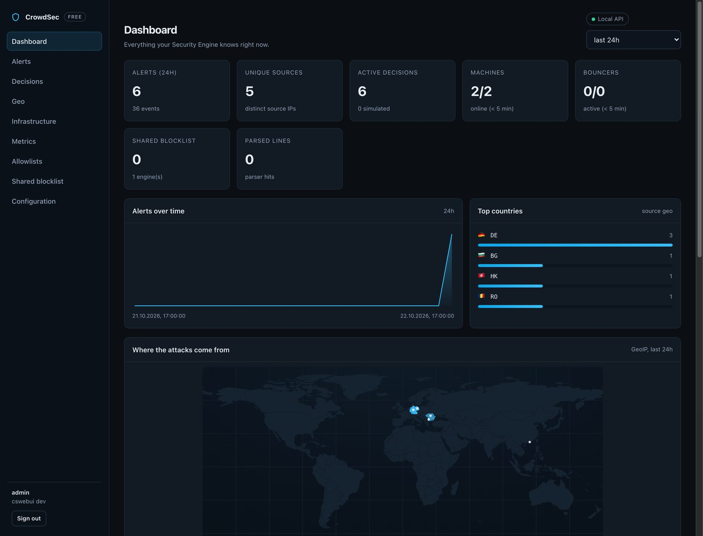

<p align="center">

</p>

<h1 align="center">CrowdSec: open-source IDS/IPS, WAF and bot detection</h1>

<p align="center">

<a href="docs/self-hosted.md">Self-hosted docs</a> ·
<a href="deploy/docker/README.md">Docker deployment</a>
</p>

> **This is the `crowdsec_free` fork.** The security engine itself is upstream
> CrowdSec, unchanged; `cscli` gains one flag and the fork ships a
> **self-hosted web UI** plus a **self-hosted blocklist server**, so monitoring,
> configuration and blocklist sharing work without the crowdsec.net console and
> without a subscription. Upstream project:
> [crowdsecurity/crowdsec](https://github.com/crowdsecurity/crowdsec).

_CrowdSec is an open-source and participative security solution offering crowdsourced server detection and protection against malicious IPs. Detect and block with our Security Engine, contribute to the network, and enjoy our real-time community blocklist._

<p align="center">

</p>

## What this fork adds

| Component | Purpose |
| --------- | ------- |
| `cswebui` | Self-hosted web UI: dashboard (alerts, origin map, parsers, buckets), alerts, decisions, allowlists, infrastructure, metrics, config editor, engine reload. Local accounts, CSRF protection, embedded assets — no external CDN. |
| `csblocklistd` | CAPI-compatible blocklist server: engines register, push manual bans and pull a shared list. Served decisions look like the usual community blocklist. |
| `cscli capi register --url ...` | One added flag so engines can register against your own server. The default stays `api.crowdsec.net`. |
| `deploy/docker/` | Single-image Compose stack (engine + UI + blocklist server) with idempotent bootstrap, hub/GeoIP download and healthchecks. |

The UI reads the LAPI SQLite database read-only (machines, bouncers, country/AS
aggregates) and scrapes the engine's Prometheus endpoint (parser, bucket,
acquisition and LAPI statistics). Details, security notes and limitations:
[docs/self-hosted.md](docs/self-hosted.md).

## Quick start

### Docker Compose (recommended)

```sh
git clone https://github.com/osxdoc/crowdsec_free.git
cd crowdsec_free/deploy/docker
cp .env.example .env      # set WEBUI_ADMIN_PASSWORD and BLOCKLIST_ADMIN_TOKEN
docker compose up -d --build
```

Open `http://<host>:8081` and log in as `admin`. The one-shot bootstrap
registers the engine, installs the `crowdsecurity/linux` collection plus
GeoLite2 data, and subscribes the engine to the bundled blocklist server.
See [deploy/docker/README.md](deploy/docker/README.md) for log sources, ports,
bouncers, backups and troubleshooting.

### From source

```sh
gmake build        # crowdsec and cscli (GNU make >= 4.1)
gmake build-tools  # cswebui and csblocklistd
```

Configuration examples live in [config/webui.yaml](config/webui.yaml) and
[config/blocklist.yaml](config/blocklist.yaml); full setup in
[docs/self-hosted.md](docs/self-hosted.md).

## Point other engines at your blocklist server

The bundled server replaces the Central API for sharing decisions:

```sh
cscli capi register --url http://<host>:8082/ -f /etc/crowdsec/online_api_credentials.yaml
systemctl reload crowdsec
```

By default only manual bans are shared (`origin: cscli`); scenario hits can be
enabled per engine and on the server. The UI manages entries, connected engines
and their countries/networks.

## Features & Advantages

### Versatile Security Engine

[CrowdSec Security Engine](https://docs.crowdsec.net/docs/next/intro/) is an all-in-one [IDS/IPS](https://docs.crowdsec.net/docs/next/log_processor/intro) and [WAF](https://docs.crowdsec.net/docs/next/appsec/intro).

It detects bad behaviors by analyzing log sources and HTTP requests, and allows active remediation thanks to the [Remediation Components](https://docs.crowdsec.net/u/bouncers/intro).

[Detection rules are available on our hub](https://hub.crowdsec.net) under MIT license.

### Self-hosted UI instead of the hosted console

Upstream CrowdSec offers a hosted console with paid plans. This fork replaces it
with `cswebui`, which runs next to the engine and talks to the local API only:

- alerts with origin map, countries, networks (AS) and event details
- active decisions, manual bans and unbans, centralized allowlists
- machines, bouncers, parser/bucket/acquisition and LAPI metrics
- configuration editor for `acquis.yaml`, `profiles.yaml`, `console.yaml`
  with YAML validation, backups and a reload button

No account needed, and nothing is sent to crowdsec.net unless you configure the
engine that way. The UI is served from the same repository and works offline.

### Community blocklist or your own

Upstream's community blocklist is pulled from the Central API. This fork adds
`csblocklistd`, a compatible server you host yourself: engines push their
signals there and pull the aggregated list, so a fleet can share detections
without an external account. The two are alternatives — the engine points at one
CAPI URL.

### Multiple Platforms support

[](https://docs.crowdsec.net/)

## How CrowdSec compares

**To fail2ban** — CrowdSec reads the same log files and bans the same IPs, but
detection and remediation are decoupled: parse logs on one machine, block at the
firewall, reverse proxy or CDN on another. Attacks you report feed a community
blocklist, so an IP that hits one user gets blocked for everyone else before it
reaches them.

**To ModSecurity, Coraza and naxsi** — the AppSec component is a WAF built on
Coraza, so SecLang rules and the OWASP Core Rule Set load as-is. On top of that
it adds a YAML rule format, and shares the IP reputation and remediation layer
with the log-based engine.

**Bot and scraper detection** — AppSec can answer a suspicious request with a
JavaScript proof-of-work challenge at a tunable difficulty, which stops headless
browsers and scrapers while letting verified crawlers such as Googlebot through.

## Outnumbering hackers all together

By sharing the threat they faced, all users are protecting each other (hence the name Crowd-Security). Crowdsec is designed for modern infrastructures, with its "*Detect Here, Remedy There*" approach, letting you analyze logs coming from several sources in one place and block threats at various levels (applicative, system, infrastructural) of your stack.

CrowdSec ships by default with scenarios (brute force, port scan, web scan, etc.) adapted for most contexts, but you can easily extend it by picking more of them from the **[HUB](https://hub.crowdsec.net)**. It is also easy to adapt an existing one or create one yourself.

## Installation

The engine, hub and bouncers are installed exactly like upstream:
[follow the CrowdSec documentation](https://docs.crowdsec.net/) for Linux,
Windows, Docker, OpnSense, Kubernetes and more.

The two extra services are built with `gmake build-tools` or deployed with the
Compose stack above; their configuration is documented in
[docs/self-hosted.md](docs/self-hosted.md).

## Resources

 - [Self-hosted setup](docs/self-hosted.md): web UI, blocklist server, data sources, limitations.
 - [Docker deployment](deploy/docker/README.md): Compose stack, bootstrap, operations.
 - [Documentation](https://docs.crowdsec.net): upstream engine, hub and bouncer docs.
 - [Hub](https://hub.crowdsec.net): scenarios, parsers and remediation components.
 - [Discord](https://discord.gg/crowdsec): upstream community chat.
 - [Public Roadmap](https://roadmap.crowdsec.net/): vote on upstream features.
 - [CrowdSec Academy](https://academy.crowdsec.net/): upstream courses.
 - [Console](https://app.crowdsec.net): the hosted upstream console. Optional and
   paid; this fork does not require it.
